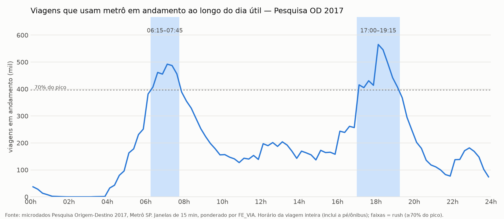
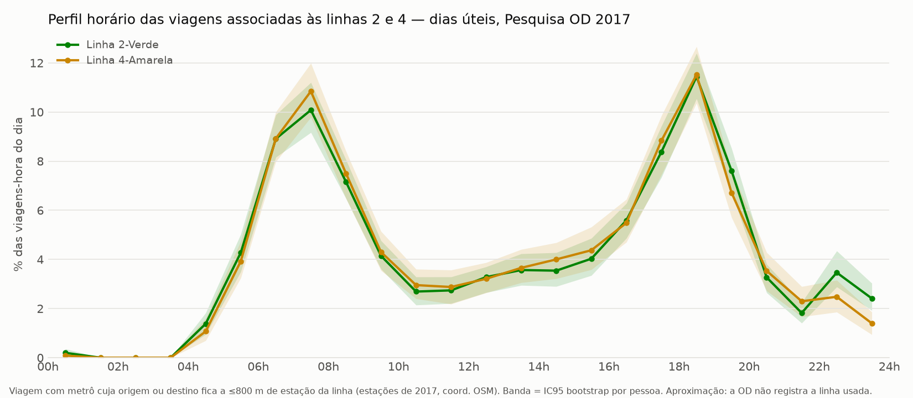
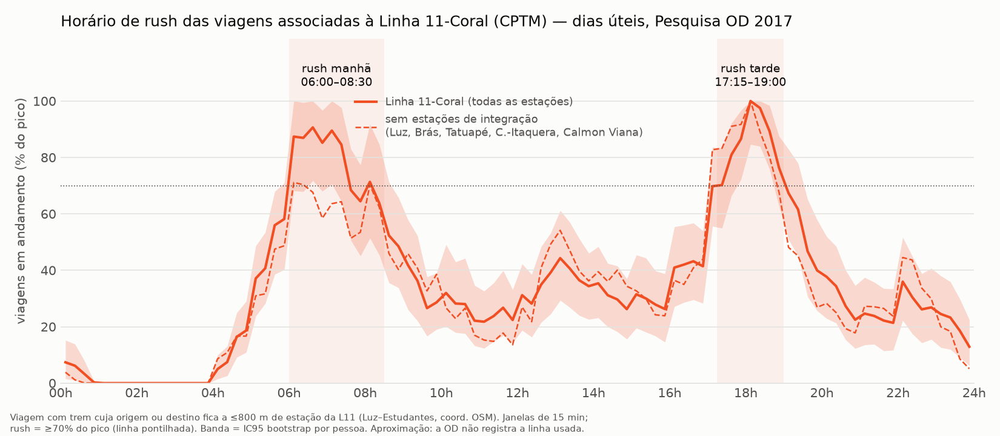

# Horários de rush no metrô e trem de SP (Pesquisa OD 2017)

Estimativa do ciclo diurno e dos períodos de rush, em dia útil, a partir dos microdados da
Pesquisa Origem-Destino 2017 do Metrô de São Paulo. As viagens são ponderadas pelo fator de expansão (`FE_VIA`).

- **Sistema metroviário:** viagens que usam metrô ou monotrilho em algum trecho.
- **Linhas 2-Verde e 4-Amarela:** viagens com metrô ancoradas perto das estações de cada linha.
- **Linha 11-Coral (CPTM):** viagens com trem ancoradas perto das estações da linha.

## Resultados principais

| Recorte | Rush manhã | Rush tarde |
| --- | --- | --- |
| Metrô (sistema) | 06:15–07:45, pico 07:00 | 17:00–19:15, pico 18:00 |
| Linhas 2 e 4 | 06h–08h, pico 07h | 17h–19h, pico 18h |
| Linha 11-Coral | 06:00–08:30, platô 06:00–07:30 | 17:15–19:00, pico 18:00 |

Rush é o período com intensidade de pelo menos 70% do pico. Os intervalos de confiança estão em `dados/processados/bootstrap_picos*.txt`.





## Como rodar

```bash
python3 -m venv .venv && .venv/bin/pip install -r requirements.txt
.venv/bin/python scripts/01_extrair.py   # baixa OD-2017.zip (~42 MB) -> dados/processados/od2017_viagens.pkl
.venv/bin/python scripts/02_ciclo.py     # -> ciclo_metro_15min.csv, bootstrap_picos.txt
.venv/bin/python scripts/03_plot.py      # -> figuras/ciclo_metro_od2017.png
.venv/bin/python scripts/04_linhas.py    # -> perfil_horario_linhas.csv, figuras/perfil_horario_l2_l4.png
.venv/bin/python scripts/05_linha11.py   # -> perfil_linha11_15min.csv, bootstrap_picos_linha11.txt, figuras/rush_linha11_coral.png
```

A OD não registra a linha usada na viagem. Por isso, `04_linhas.py` e `05_linha11.py` atribuem cada viagem a uma linha por proximidade:

- **Critério:** a origem ou o destino fica a até 800 m de uma estação da linha. Contam só as estações em operação em 2017.
- **Modo exigido:** metrô ou monotrilho para as linhas 2 e 4; trem para a Linha 11.
- **Coordenadas:** vêm do OpenStreetMap, em `dados/brutos/osm_linhas_2_4.json` e `dados/brutos/osm_linha_11.json`.
- **Teste de robustez:** uma variante descarta as estações de integração, onde a linha usada é mais ambígua.

## Limitações

- **Dados de 2017, antes da pandemia:** a OD 2023 indica que o pico da manhã ficou mais cedo, mas os microdados dela ainda não são públicos.
- **Horário da viagem inteira:** inclui caminhada e ônibus, não só o trecho sobre trilhos.
- **Atribuição por linha é aproximada:** em estações de integração, viagens de linhas diferentes se misturam. A Linha 11 tem amostra pequena (682 viagens).
- **Sem separação por sentido.**
- **Volume de viagens não é lotação do trem:** a frota aumenta no pico.

## Fontes e licenças

- **Microdados da Pesquisa OD 2017:** Metrô de São Paulo, acesso público e gratuito pelo
  [Portal da Transparência](https://transparencia.metrosp.com.br/dataset/pesquisa-origem-e-destino).
  Não estão neste repositório; o `01_extrair.py` baixa os arquivos.
- **Coordenadas das estações:** © colaboradores do [OpenStreetMap](https://www.openstreetmap.org/copyright),
  sob licença [ODbL](https://opendatacommons.org/licenses/odbl/).
- **Código:** licença MIT, ver [LICENSE](LICENSE).
